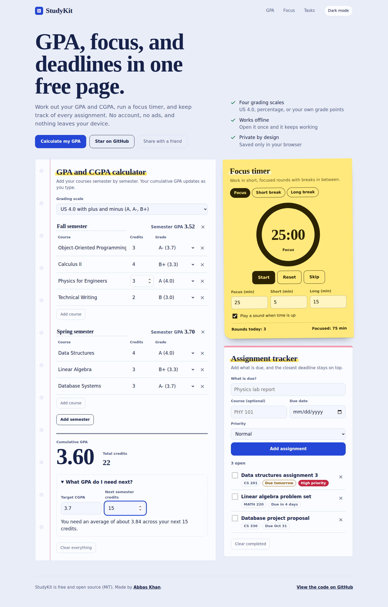

# StudyKit

**A free GPA calculator, focus timer, and assignment tracker for students.**
No sign-up, no ads, works offline, and your data never leaves your device.

**[Open StudyKit](https://khan02-coder.github.io/studykit/)**



## What it does

**GPA and CGPA calculator**
- Add courses semester by semester and see your semester GPA and cumulative GPA update as you type.
- Four grading scales: US 4.0 with plus and minus, US 4.0 letters only, percentage (0 to 100), and your own grade points on any scale.
- A target planner that tells you what average you need in your next semester to reach a target CGPA.

**Focus timer**
- Focus, short break, and long break modes (25, 5, and 15 minutes by default, all editable).
- A long break after every fourth focus round, a sound when time is up, and a count of today's rounds and focused minutes.
- The countdown also shows in the browser tab title, so you can see it from another tab.

**Assignment tracker**
- Add assignments with a course, a due date, and a priority.
- The closest deadline always stays on top, with clear labels like "Due tomorrow" and "Overdue by 2 days".

**Also**
- Light and dark themes.
- Works offline after the first visit.
- Everything is saved in your browser only. No accounts, no cookies, no analytics.
- Keyboard friendly, and it respects reduced-motion settings.
- Plain HTML, CSS, and JavaScript. No build step and no dependencies.

## Grading scales

Grade points differ between universities, so check your own university's table.

| Grade | US 4.0 (plus and minus) | US 4.0 (letters only) |
|-------|-------------------------|-----------------------|
| A     | 4.0                     | 4.0                   |
| A-    | 3.7                     |                       |
| B+    | 3.3                     |                       |
| B     | 3.0                     | 3.0                   |
| B-    | 2.7                     |                       |
| C+    | 2.3                     |                       |
| C     | 2.0                     | 2.0                   |
| C-    | 1.7                     |                       |
| D+    | 1.3                     |                       |
| D     | 1.0                     | 1.0                   |
| F     | 0.0                     | 0.0                   |

If your university uses a different system, choose **My own grade points**, set the scale maximum (for example 10), and type the grade points from your transcript.

Results are estimates. For official numbers, always check with your university.

## Run it yourself

1. Download or clone this repository.
2. Open `index.html` in your browser.

To test the offline feature locally, serve the folder instead of opening the file directly:

```
python -m http.server 8000
```

Then visit `http://localhost:8000`.

## Ideas and contributions

Ideas and pull requests are welcome. Some things that would make StudyKit better:
- More grading scales (for example UK degree classes)
- Export and import of your data
- A flashcard tool
- Translations

Open an issue to start a conversation.

## License

MIT. See [LICENSE](LICENSE). Made by [Abbas Khan](https://khan02-coder.github.io/my-first-project/).
